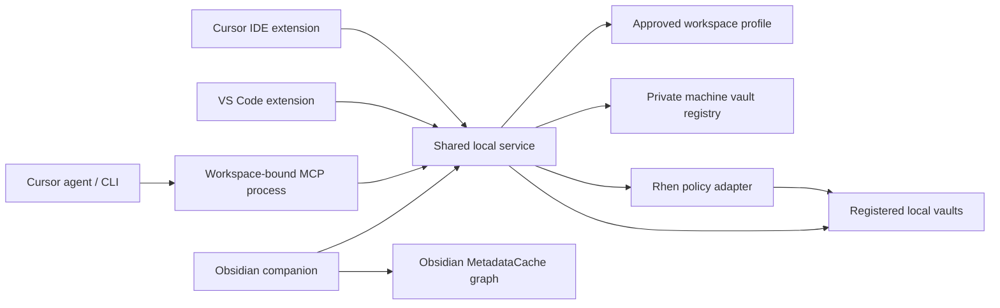

# Architecture

The product has three repositories and one policy model. This repository owns the editor/harness; KnowledgeBridge owns the Obsidian companion; KnowledgeBridgeCore owns the shared engine. Both consumers pin a compiled core commit archive and bundle it independently. Editor UI and agent tools must go through the same scoped service rather than maintaining separate interpretations of vault access.

## Implemented dependency boundaries

`core` is host-independent TypeScript. It defines schemas, scope filtering, note/chunk representations, graph resolution and lexical retrieval. It imports neither VS Code nor Obsidian. Embedding and change-event contracts live here for later implementations.

`local-service` owns Node filesystem access, content hashing, approved-profile loading, size limits and create-only writes. Hosts call this service directly; MCP wraps it without exposing arbitrary filesystem paths. Each process receives exactly one registry path and one approved profile path at startup. Tools cannot switch profiles or select an unregistered vault.

`rhen-adapter` is a small, independently implemented compatibility reader. It consumes known policy metadata and recognizes encrypted envelopes. It neither imports Rhen's private source nor performs cryptography. Its conservative behavior is described in [RHEN.md](RHEN.md).

`vscode-extension` owns the vault catalog UI, workspace setup, search previews, selection capture and MCP registration. Host-specific code is confined to the Cursor API detector and the VS Code MCP provider. Cursor APIs are feature-detected, not assumed from the app's name. A standalone configuration can be exported when an extension API is unavailable or for the CLI.

`obsidian-plugin` owns settings for connecting the same catalog/profile, browsing current-vault notes, native graph navigation, and scoped selection capture. It uses Obsidian metadata for native graph resolution only after the service builds the authorized set. It never trusts a decrypted editor buffer without first checking that the source note is shareable through the service.

## Knowledge flow

**Explicit chat context:** the workspace skill invokes `knowledge_select` → the server negotiates MCP Apps support → `chat-ui` renders shared vault/document chips → UI-only `knowledge_picker` operations use `local-service/ComposerSessions` → explicit delivery rechecks policy and selected revisions → the app sends the chosen reference bundle to the current chat. App-only metadata keeps intermediate choices out of model tool output. Random session handles isolate concurrent pickers; expiry, revision checks and close invalidate stale selections.

The same built HTML runs in an editor webview with a nonce-based content policy and a clipboard bridge. Its host revalidates before copying. Older MCP clients receive elicitation forms backed by the existing `core` picker. Native MCP prompts expose dependent single-document completion with bounded suggestions and per-server request/concurrency limits. All routes use the same service boundaries and budget, without automatic graph expansion. See [CHAT.md](CHAT.md).

**Obsidian → session:** search tool → reload registry/profile → confirm local approval → filter paths → enforce Rhen → read raw disk text → reject encrypted envelopes → parse/filter tags → rank chunks → add in-scope graph neighbors → return citations. External links are not fetched. Note text is explicitly untrusted reference data.

**Session → Obsidian:** user invokes capture or authorizes an agent capture → service validates destination → checks current Rhen policy and profile approval → creates a new Markdown note exclusively → includes workspace/request/source/session metadata. A repeated identical request returns the same result; a reused request ID with different content conflicts. Wiki links participate in Obsidian's graph after its normal file detection.

The preview creates the file through Node so it also works while Obsidian is closed. It never updates an existing note. Future in-place edits should be sent through an Obsidian adapter using `Vault.process` plus expected revision checks; offline writes need a coordinated writer and conflict handling before they are supported.

## Settings ownership

There is one machine catalog per editor extension installation, outside the repository. Obsidian points to it explicitly. Cursor and VS Code may have different application-storage directories; share a chosen catalog manually only when that is intended. Workspace profiles contain logical IDs and scopes; the local catalog contains absolute paths and profile approvals. No vault discovery or grant is inferred from whichever note happens to be open.

The initial UI uses native settings, commands, directory pickers and profile editing. A richer settings view can use these exact schemas and service methods. Obsidian is a companion consumer of the catalog; multi-vault registration remains in the editor settings because only that surface knows the code workspace.

## Scope of the trust boundary

No plugin can confine another process running with the same filesystem rights. Local approvals prevent accidental or unreviewed repository-profile expansion through this service. They are not an OS sandbox. Revalidating symlinks, lock metadata and contents reduces mistakes; hostile concurrent filesystem replacement requires OS separation. The public interface does not offer unlock, arbitrary writes, shell execution or network fetches.

All model-visible content is an intentional export to the MCP client. Once a client has received plaintext, later sealing cannot erase it from chat history, model context, logs, clipboard or an unsaved editor preview. Persistent indexes and captured summaries require separate retention policies; they are not transparent caches.

## Planned service evolution

Move costly retrieval into one local worker per approved workspace, with transport-neutral APIs. Use an authenticated per-user local socket or named pipe if hosts share a daemon; do not bind an unauthenticated HTTP server. Pairing must fix the workspace and authorize capabilities before any note metadata is returned. Preserve standalone stdio for simple deployments.

Add Obsidian event ingestion, durable incremental indexing, transactional writes, and policy-revision notifications behind the same contracts. Only the adapter changes; tool names, profile semantics and citations stay stable. Remote execution, WSL and containers need an explicitly paired local bridge and separate threat model; this preview rejects remote editor workspaces.
